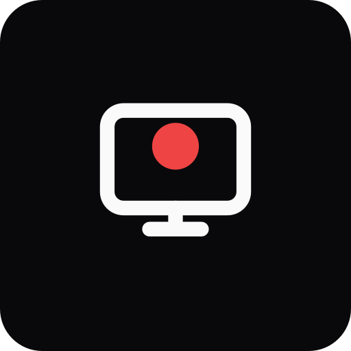
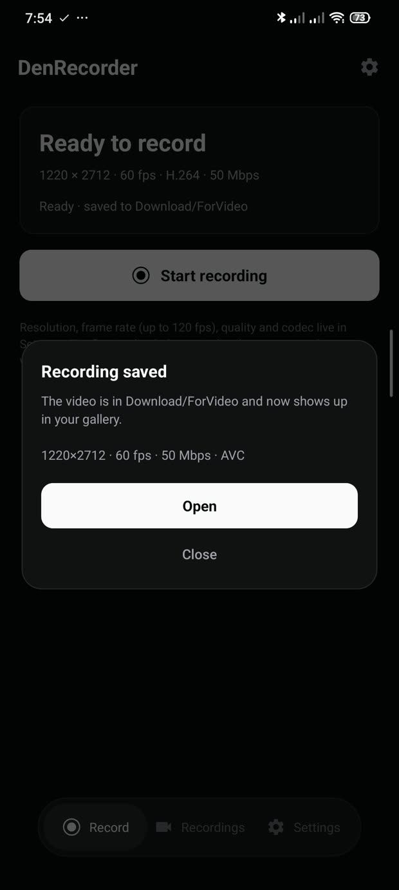
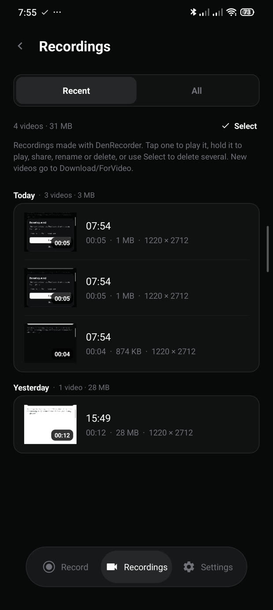
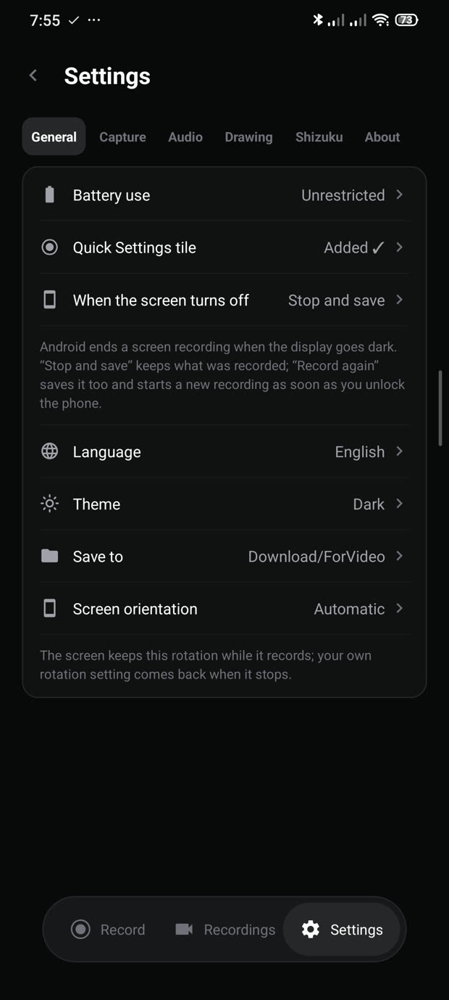

<p align="center">
  
</p>

# DenRecorder

A small, fast screen recorder for Android — native MediaCodec recording, no ads, no tracking.

🇬🇧 English · [🇻🇳 Tiếng Việt](#tiếng-việt)

<p align="center">
  
  
  
</p>

---

## English

DenRecorder records the whole screen (and the device audio, the microphone, both together or nothing) straight from Android's own encoders. It is written in plain Java against the Android framework, so the APK stays small (about 160 KB, most of it the Shizuku client behind the beta island feature).

### Features

- **Exact screen size** — a native recording is saved at the real screen resolution (for example 1220 × 2712), not scaled down to the encoder's 16-pixel grid.
- **Quality presets** — Native, 4K, 2K, Full HD, HD and SD, keeping the screen's aspect ratio. Videos stay inside what phone decoders handle (3840 px on the long side, H.264 level 5.1 frame size), so a 4K recording plays in every gallery and player.
- **15–50 Mbps** variable bitrate, **H.264 AVC** or **H.265 HEVC**, up to **120 fps**.
- **Audio** — internal device audio (Android 10+), the microphone, **both mixed into one track** (the device sound and your voice together in one AAC track), or silent. If the microphone is unavailable or not allowed, the recording keeps the device sound instead of losing all audio.
- **Quick Settings tile** — tap to start and stop without opening the app (with a toast when the recording starts or is saved); press and hold the tile to open the app.
- **One tap to record (optional, Shizuku)** — Android asks for the screen-capture permission every time; with Shizuku running, DenRecorder presses that button itself as soon as the dialog is up, at the place it found the first time, so recording starts at once. Android 16 gives an app no way to skip the dialog completely, even with the app-op set; the dialog is gone in well under a second. The option can be turned off again in Settings.
- **Xiaomi Super Island (beta, Xiaomi only)** — the running recording shows up in HyperOS's island as a small icon with its timer, and a tap on it gives **pause, resume and stop** right on the bar (the stop button is a filled square, not a cross); it can be hidden entirely, and HyperOS hides it by itself whenever the status bar is pulled down (the notification there carries the same buttons). Needs Shizuku once to grant the island permission.
- **Game performance mode** — caps the recorder at 60 fps and runs the encoder in realtime priority, so a game next to it keeps its frame rate.
- **Recordings screen** — old and new videos are grouped by day (**Today**, **Yesterday**, then the date) with a count and a size for each day, a first-frame thumbnail carrying the video's length, and a bigger "All" list that loads 40 more rows at a time. Tap to play, long-press for play/share/trim/**rename**/delete, or tap **Select** to pick several videos and delete them at once.
- **Search, filter and sort** — a search field finds a video by name, folder, day or resolution, and two chips narrow the list to the last 7 or 30 days (or today and yesterday) and order it by newest, oldest, largest, smallest, longest or shortest. The summary shows how many of the videos match, and both chips keep their choice the next time the app opens.
- **Trim a recording** — long-press a video and pick **Trim**: two sliders choose where it starts and ends, with the frame at each end shown right above them as the sliders move, and the piece between them is saved as a new video without re-encoding, so the original stays exactly as it was. A cut begins on the nearest key frame, which can make it up to a second longer; a tick deletes the original once the cut is safely saved.
- **File names and GitHub** — every row in the recordings list shows the video's real file name (`DenRecorder_20261121_151347.mp4`), so it is easy to find in a file manager, and Settings → About → **GitHub** opens this repository.
- **Draw on screen** — a floating button while recording: pencil, rectangle or circle drawn straight onto the screen (they end up in the video), pause and stop from the same bar. A tool stays picked, so several shapes can be drawn one after another, and the bar carries the whole palette (12 colours): the colour can be changed in the middle of a recording, and every shape keeps the colour it was drawn with. The **✕** stops drawing: the tool goes off, the bar closes and the app under it takes taps again, while what was drawn stays on screen. The button carries a red ring while a tool is on, and touching the screen beside the bar hides it but keeps the tool, so a tool, a colour and a stroke take one visit to the bar. The button's size and whether it stays in sight are picked in settings.
- **Pause and resume** — one recording stays one file; the paused time is cut out of the video and the timer stops while paused.
- **The screen stays awake** — the display is kept on (dimmed) for as long as a recording runs, so a phone that would have napped mid-game does not put a black stretch in the video.
- **Screen off while recording** — Android ends a screen recording when the display goes dark, so Settings → When the screen turns off picks what happens: **Stop and save** keeps what was recorded and says why it stopped, or **Record again when the screen is back** saves it too and starts a new recording by itself as soon as the phone is unlocked (Fast start makes it begin without a tap). Nothing fails either way.
- **Updates from GitHub** — the newest release is read from this repository when the app opens, and a newer version is offered on the record screen and in Settings → About → Updates. **Download and install** fetches the APK and hands it straight to Android's installer, so the update happens in the app; Android asks once, and the first time it also asks to allow "Install unknown apps" for DenRecorder.
- **Settings in tabs** — General first, then Capture, Audio, Drawing, Shizuku and About. Drawing holds everything that puts something on the screen, Shizuku holds Fast start, the connection status and Super Island (Xiaomi), so each part is found without scrolling through the rest.
- **The button stays in sight, the video stays clean** — the floating button is visible the whole time it records, and it follows the finger smoothly when dragged. Settings → Button while recording can fade it to a fifth instead (still in sight, out of the way), and while an area is recorded it steps just outside the saved part, so the video holds the drawing only. Starting, pausing, resuming and stopping are announced by the notification and a short vibration instead of toasts, so the app's own messages stay out of the recording. Android records the screen exactly as it is, so a whole-screen recording does hold the button; with an area picked, only that area is saved.
- **Built-in player** — a recording opens in DenRecorder's own player (play/pause, seek, double-tap to jump 10 s back or forward, and a rotate button that turns the video even when the phone's rotation is locked), so the video you tap is the video you get, whatever gallery app is installed.
- **Choose where videos go** — `Movies/Screen Recorder` by default, five presets, the phone's own folder browser, or a typed path, including `Download` (videos land in the Downloads collection so MIUI keeps them there).
- **Record a part of the screen** — Settings → Recording area → Choose an area… floats a frame over whatever app you are in. After Save the same ball becomes the record button: tap it to start and tap again to stop from inside the app or game, hold it to change the frame. While recording it steps just outside the frame, so the video holds only the area itself. When the recording ends the ball and its notification close themselves; **Hủy** in the frame closes everything, while **Ẩn khung** keeps the ball ready to record.
- **Recording rotation** — automatic, portrait or landscape: the screen is locked to that rotation for the whole recording (your phone's own rotation setting comes back afterwards), so the video never turns halfway through.
- **Long recordings** — the notification uses the system chronometer (no wake-ups every second), storage is checked every 15 s, recording stops safely before the card fills up.
- **Five languages** — English, 中文, 日本語, 한국어 and Tiếng Việt, English first in the list; the choice is remembered and the whole UI switches with it.
- **Shadcn-style UI** — dark, light or automatic (follows the phone), a floating bottom bar, screens that rise in part by part and short, subtle animations.
- **Android 5.1 (SDK 22) to Android 16 (SDK 36).**

### Install

1. Download `DenRecorder-1.10.15.apk` from the [Releases](../../releases) page.
2. Open it on the phone and allow installing apps from that source if asked.
3. Open DenRecorder, allow the permissions it asks for, and optionally let it add the Quick Settings tile.

### Permissions

| Permission | Why |
| --- | --- |
| Screen capture (asked by Android) | to record the display |
| Microphone | only if you pick the microphone as audio source |
| Notifications | the ongoing "recording" notification, Android 13+ |
| Storage (Android 9 and older) | to write the MP4 into the folder you picked |
| Ignore battery optimizations (optional) | keeps long recordings and the tile reliable |
| Modify system settings (optional) | only if you pick a fixed recording rotation, so the screen can be locked while it records; with Shizuku it is not needed |

### Build from source

Requirements: a JDK 17+, Android SDK build-tools (`aapt2`, `d8`, `apksigner`) and `platforms/android-36/android.jar`. Gradle is not needed.

```bash
export ANDROID_HOME=$HOME/android-sdk   # folder with android-36/android.jar and build-tools
./build.sh                              # writes build/app.apk
```

`app.properties` holds `versionCode`, `versionName` and `minSdk`. The first build creates a signing key in `~/.denrecorder-keys` and reuses it afterwards.

### Project layout

```
AndroidManifest.xml
app.properties          versionCode / versionName / minSdk
build.sh                build without Gradle
java/com/bkggds/denrecorder/
  MainActivity.java     screens, settings, recordings list, dialogs
  PlayerActivity.java   built-in video player for the recordings
  ScreenRecorder.java   MediaCodec + MediaMuxer pipeline
  RecorderService.java  foreground service, notification, toasts
  RotationLock.java     locks the screen rotation while recording
  QsTileService.java    Quick Settings tile
  CapturePromptActivity.java  transparent capture-consent trampoline
  Island.java           Xiaomi Super Island (beta) notification extras
  ShizukuBridge.java    Shizuku: one shell command, the island permission
  LocaleHelper.java     language switching (EN, ZH, JA, KO, VI)
libs/                   Shizuku API (Apache-2.0, RikkaW) for the beta feature
res/                    strings (EN + VI), icons, launcher icons
```

### License

MIT — do what you like, keep the credit.

Made with ♥ by BKggDs

---

## Tiếng Việt

DenRecorder quay toàn bộ màn hình (kèm âm thanh thiết bị, micrô, cả hai hoặc không âm thanh) bằng chính bộ mã hóa của Android. Ứng dụng viết bằng Java thuần trên Android framework nên APK rất nhẹ (khoảng 160 KB, phần lớn là thư viện Shizuku cho tính năng đảo beta).

### Tính năng

- **Đúng kích thước màn hình** — bản quay "Gốc" lưu đúng độ phân giải thật (ví dụ 1220 × 2712), không bị hạ xuống mốc chia hết cho 16.
- **Chọn chất lượng** — Gốc, 4K, 2K, Full HD, HD, SD, giữ đúng tỉ lệ màn hình.
- **15–50 Mbps**, **H.264 AVC** hoặc **H.265 HEVC**, tới **120 fps**.
- **Âm thanh** — âm thanh trong máy (Android 10 trở lên), micrô, **cả hai hoà vào một track** (tiếng máy và giọng bạn cùng nằm trong một track AAC), hoặc không có. Nếu không lấy được micrô hoặc chưa cấp quyền, bản ghi vẫn giữ tiếng máy thay vì mất hết âm thanh.
- **Nút trên Trung tâm điều khiển** — chạm để bắt đầu và dừng quay mà không cần mở ứng dụng (có toast khi bắt đầu và khi đã lưu); nhấn giữ nút để mở ứng dụng.
- **Một chạm là quay (tùy chọn, cần Shizuku)** — Android hỏi quyền quay màn hình mỗi lần; khi Shizuku đang chạy, DenRecorder tự bấm nút đó ngay khi hộp thoại vừa hiện, đúng chỗ tìm được lần đầu, nên ghi gần như tức thì. Android 16 không cho ứng dụng thường bỏ hẳn hộp thoại (đặt app-op PROJECT_MEDIA cũng không qua được, đã thử); hộp thoại chỉ loé lên dưới một giây. Có thể tắt lại trong Cài đặt.
- **Super Island của Xiaomi (beta, chỉ máy Xiaomi)** — bản ghi đang chạy hiện trên đảo của HyperOS dưới dạng một biểu tượng nhỏ kèm đồng hồ đếm, chạm vào đảo là **tạm dừng, tiếp tục và dừng** ngay trên thanh đó; có thể tắt hẳn, và HyperOS tự ẩn đảo khi bạn kéo thanh trạng thái xuống (thông báo ở đó có đúng các nút này). Cần Shizuku một lần để cấp quyền hiện đảo.
- **Chế độ hiệu năng khi chơi game** — giới hạn 60 fps và ưu tiên thời gian thực cho bộ mã hóa, để game đang chạy bên cạnh vẫn mượt.
- **Màn Bản ghi** — bản ghi cũ và mới được gom theo ngày (**Hôm nay**, **Hôm qua**, rồi tới ngày cụ thể) kèm số lượng và dung lượng từng ngày, ảnh thu nhỏ là khung hình đầu có ghi độ dài video, và danh sách **Tất cả** tải thêm 40 dòng mỗi lần bấm *Xem thêm*. Chạm để xem, giữ để xem/chia sẻ/cắt/**đổi tên**/xóa, hoặc bấm **Chọn** để chọn nhiều bản ghi và xóa một lần.
- **Tìm, lọc và sắp xếp** — ô tìm kiếm tìm bản ghi theo tên file, thư mục, ngày hoặc độ phân giải; hai nút bên dưới lọc theo thời gian (tất cả, hôm nay, hôm qua, 7 ngày, 30 ngày) và sắp xếp theo mới nhất, cũ nhất, dung lượng lớn/nhỏ, dài/ngắn. Dòng tổng cho biết bao nhiêu bản ghi khớp, và lựa chọn được nhớ cho lần mở sau.
- **Cắt bản ghi** — giữ một video rồi chọn **Cắt**: hai thanh trượt chọn chỗ bắt đầu và kết thúc, khung hình ở hai đầu hiện ngay phía trên và đổi theo thanh trượt, đoạn ở giữa được lưu thành video mới mà không mã hoá lại, nên bản gốc vẫn y như cũ. Đoạn cắt bắt đầu từ khung hình khoá gần nhất nên có thể dài hơn tối đa một giây; có thể tích để xoá bản gốc sau khi đoạn cắt đã lưu xong.
- **Tên file và GitHub** — mỗi dòng trong danh sách bản ghi hiện đúng tên file (`DenRecorder_20261121_151347.mp4`) để dễ tìm trong trình quản lý file, và Cài đặt → Thông tin → **GitHub** mở thẳng kho dự án này.
- **Vẽ trên màn hình** — nút nổi khi đang quay: bút chì, hình chữ nhật hoặc khoanh tròn vẽ thẳng lên màn hình (có trong video), tạm dừng và dừng quay ngay trên thanh đó. Chọn công cụ một lần là vẽ được nhiều hình liên tiếp, và thanh vẽ có sẵn đủ bảng màu (12 màu): đang quay vẫn đổi màu được, mỗi hình giữ đúng màu lúc vẽ. Nút **✕** để dừng vẽ: công cụ tắt, thanh đóng lại và chạm được vào app bên dưới như bình thường, còn nét đã vẽ vẫn nằm trên màn hình. Bóng có viền đỏ khi đang bật công cụ; chạm ra ngoài thanh thì thanh ẩn mà công cụ vẫn bật, nên chọn công cụ, chọn màu và vẽ chỉ trong một lần mở thanh. Kích thước nút nổi và việc nút luôn hiện hay tự ẩn chỉnh trong Cài đặt.
- **Tạm dừng và tiếp tục** — một lần quay vẫn là một file, thời gian tạm dừng được cắt khỏi video và đồng hồ đếm dừng lại khi tạm dừng.
- **Màn hình luôn sáng khi quay** — màn hình được giữ sáng (ở mức mờ) suốt lúc quay, nên máy không tự ngủ giữa chừng và video không có đoạn đen.
- **Tắt màn hình khi đang quay** — Android dừng quay khi màn hình tắt, nên Cài đặt → Khi tắt màn hình cho chọn: **Dừng và lưu** giữ phần đã quay kèm lý do dừng, hoặc **Quay tiếp khi mở máy** cũng lưu phần đó rồi tự bắt đầu bản ghi mới ngay khi bạn mở khoá máy (bật Khởi động nhanh thì không phải bấm gì). Không trường hợp nào báo lỗi.
- **Cập nhật từ GitHub** — mỗi lần mở app, bản release mới nhất được đọc từ kho GitHub này; nếu có bản mới thì màn Quay và Cài đặt → Thông tin → Cập nhật sẽ mời cập nhật. Bấm **Tải và cài** là app tải APK rồi chuyển thẳng cho trình cài đặt của Android, nên việc cập nhật diễn ra ngay trong app; Android hỏi một lần, và lần đầu còn hỏi cho phép “Cài đặt ứng dụng không rõ nguồn gốc” cho DenRecorder.
- **Cài đặt chia tab** — Chung đứng đầu, rồi Chất lượng, Âm thanh, Vẽ, Shizuku và Thông tin. Tab Vẽ gom mọi thứ hiện trên màn hình, tab Shizuku gom Khởi động nhanh, trạng thái kết nối và Super Island (máy Xiaomi), nên từng phần tìm được ngay mà không phải cuộn qua phần khác.
- **Nút luôn trong tầm tay, video vẫn sạch** — nút nổi hiện suốt lúc quay và chạy theo tay khi kéo, không còn khựng. Cài đặt → Nút vẽ khi quay có thể chọn tự mờ còn khoảng một phần năm (vẫn thấy, không vướng), và khi quay một vùng thì nút né ra ngoài phần đã chọn nên video chỉ có nét vẽ. Lúc bắt đầu, tạm dừng, tiếp tục hay dừng quay, app báo bằng thông báo và một nhịp rung ngắn thay vì toast trên màn hình. Android quay đúng màn hình, nên quay toàn màn hình thì nút vẫn nằm trong video; chọn quay một vùng thì chỉ phần đó được lưu.
- **Trình phát sẵn trong app** — chạm vào bản ghi là phát ngay trong DenRecorder (phát/tạm dừng, tua, nhấn đúp để lùi hoặc tiến 10 giây, nút xoay màn hình hoạt động cả khi điện thoại đang khoá xoay), đúng video vừa chọn dù máy dùng ứng dụng thư viện nào.
- **Chọn thư mục lưu** — mặc định `Movies/Screen Recorder`, có 5 gợi ý sẵn, duyệt thư mục bằng trình chọn của điện thoại, hoặc tự nhập.
- **Quay một vùng màn hình** — Cài đặt → Vùng quay → Chọn vùng quay… mở một khung nổi trên app bạn đang dùng. Bấm Lưu xong, chính bóng đó thành nút quay: chạm để bắt đầu, chạm lần nữa để dừng ngay trong app hay game, giữ bóng để đổi khung. Đang quay thì bóng né ra ngoài khung nên video chỉ có đúng phần đã chọn. Quay xong bóng và thông báo tự tắt; bấm **Hủy** trong khung cũng tắt hết, còn **Ẩn khung** thì giữ bóng lại để quay.
- **Hướng khi ghi hình** — tự động, dọc hoặc ngang: màn hình được khóa đúng hướng đó trong suốt lần quay (cài đặt xoay của máy được trả lại sau khi dừng), nên video không bị xoay giữa chừng.
- **Quay dài** — thông báo dùng đồng hồ đếm của hệ thống (không đánh thức mỗi giây), kiểm tra dung lượng mỗi 15 giây và tự dừng trước khi đầy bộ nhớ.
- **Năm ngôn ngữ** — English, 中文, 日本語, 한국어 và Tiếng Việt, tiếng Anh đứng đầu danh sách; lựa chọn được nhớ và cả giao diện đổi theo.
- **Giao diện tối kiểu Shadcn** với thanh điều hướng nổi và animation nhẹ.
- **Chạy trên Android 5.1 (SDK 22) đến Android 16 (SDK 36).**

### Cài đặt

1. Tải `DenRecorder-1.10.15.apk` ở mục [Releases](../../releases).
2. Mở file trên điện thoại và cho phép cài đặt từ nguồn đó nếu được hỏi.
3. Mở DenRecorder, cấp quyền khi được hỏi, có thể thêm nút vào Trung tâm điều khiển.

### Quyền ứng dụng

| Quyền | Dùng để |
| --- | --- |
| Quay màn hình (Android hỏi) | ghi lại màn hình |
| Micrô | chỉ khi chọn micrô làm nguồn âm thanh |
| Thông báo | thông báo "đang quay", Android 13 trở lên |
| Bộ nhớ (Android 9 trở xuống) | ghi file MP4 vào thư mục đã chọn |
| Bỏ tối ưu pin (tùy chọn) | giúp quay dài và nút Trung tâm điều khiển ổn định |
| Sửa cài đặt hệ thống (tùy chọn) | chỉ khi chọn khóa hướng ghi hình, để khóa màn hình trong lúc quay; có Shizuku thì không cần |

### Tự build

Cần JDK 17+, Android SDK build-tools (`aapt2`, `d8`, `apksigner`) và `platforms/android-36/android.jar`. Không cần Gradle.

```bash
export ANDROID_HOME=$HOME/android-sdk
./build.sh            # tạo build/app.apk
```

`app.properties` chứa `versionCode`, `versionName`, `minSdk`.

### Giấy phép

MIT — dùng thoải mái, giữ dòng ghi công.

Made with ♥ by BKggDs
