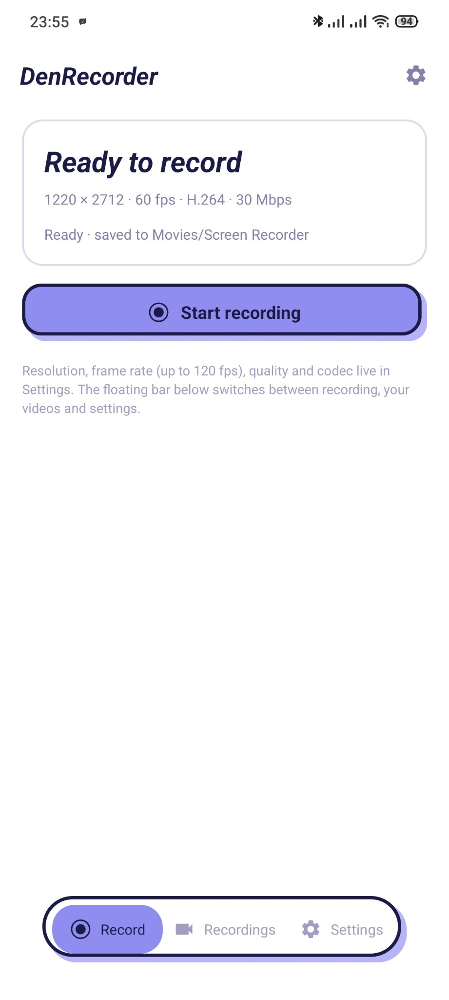
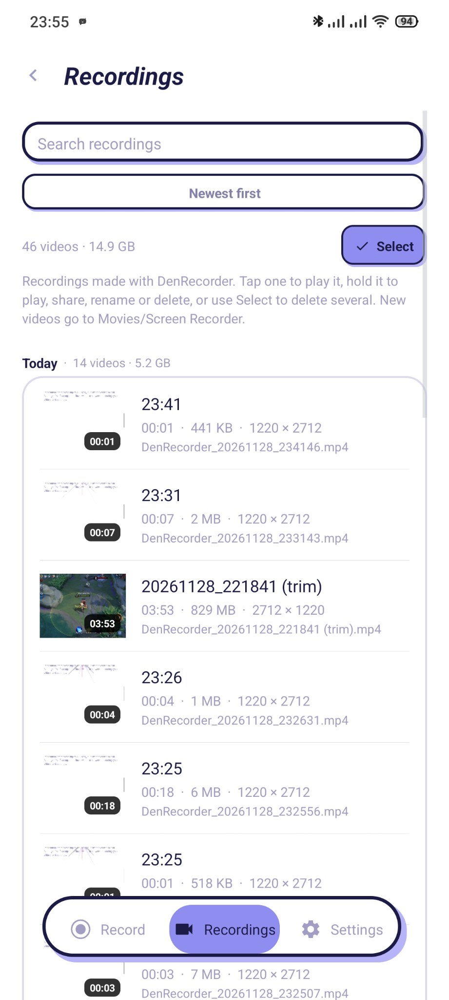
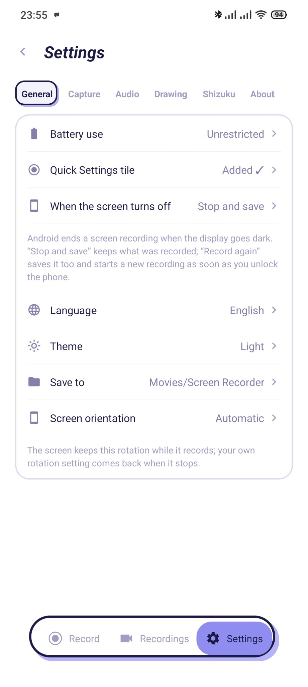
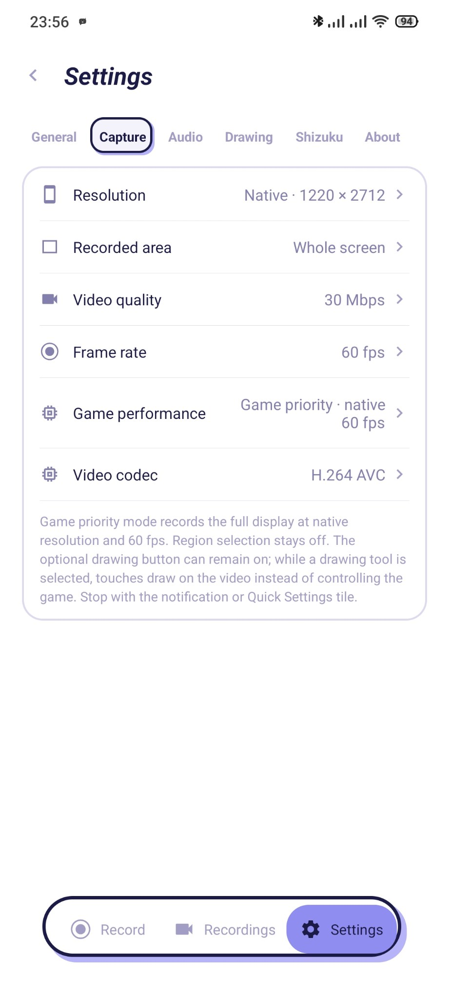
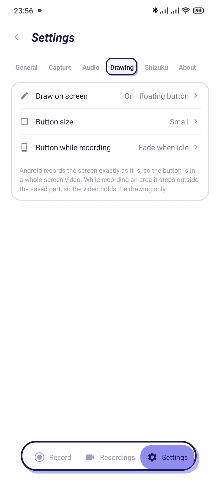
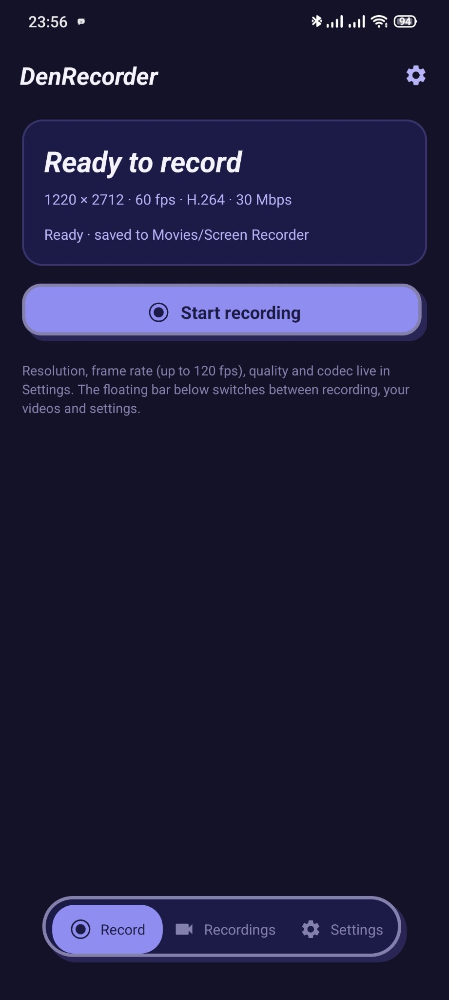
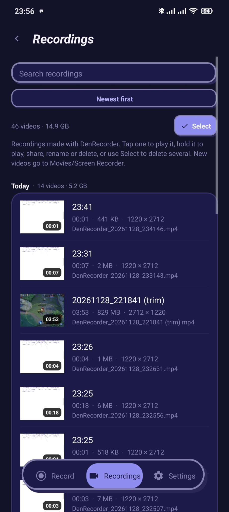
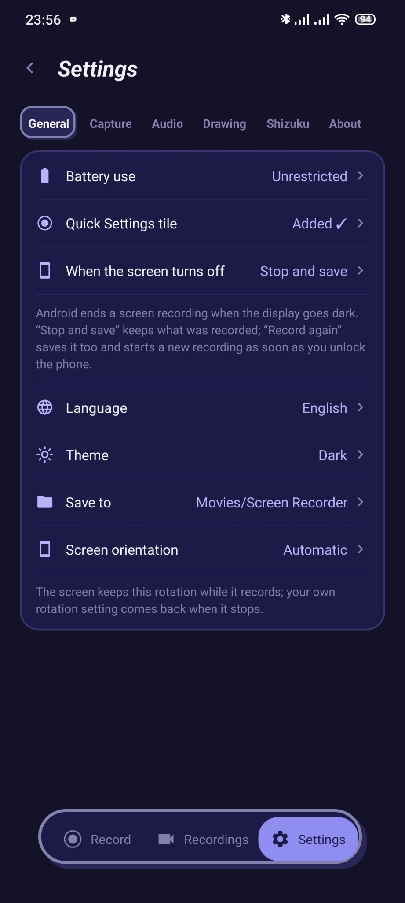
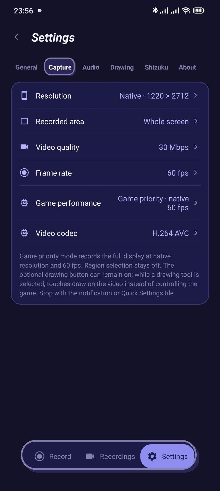

<p align="center">
  
</p>

# DenRecorder

**A simple Android screen recorder for games, tutorials and everyday use.**

Record your screen, capture device audio or your microphone, then find, play and trim videos in the same app. DenRecorder uses Android's screen-capture permission and device video encoders.

🇬🇧 English · [🇻🇳 Tiếng Việt](#tiếng-việt)

## Screenshots

**Light theme**

<p align="center">
  
  
  
</p>
<p align="center">
  
  
</p>

**Dark theme**

<p align="center">
  
  
  
</p>
<p align="center">
  
</p>

## English

### What is it for?

Use DenRecorder to save gameplay, app walkthroughs, lessons or anything else shown on your Android screen. Recordings are saved as MP4 files that you can play, share or trim.

### Main features

- **Record the screen:** start from the app or the Quick Settings tile. Android asks you to approve each screen-capture session.
- **Choose video quality:** select a resolution, frame rate, bitrate and H.264/AVC or H.265/HEVC. Available settings depend on the phone's encoder.
- **Choose audio:** record device audio (Android 10+), microphone, both together, or no audio.
- **Gaming mode:** records at the display's native size and 60 fps, caps the bitrate at 30 Mbps and asks the hardware encoder to yield resources to the game. The optional drawing toolbar follows its separate setting. Smoothness depends on the phone, game and temperature.
- **Manage recordings:** browse by day, search and sort videos, and play, share, rename or delete them. Select individual videos or use **Select all** to select every result matching the current search; confirm once to delete the selection.
- **Trim videos:** choose a start and end, preview the selection and save it as a new file. The original is kept unless you choose to delete it. Cuts start at a video keyframe, so the saved start can differ slightly from the selected point.
- **Draw while recording:** use the optional floating drawing tools to mark the screen; pause or stop from the drawing toolbar.
- **Play in the app:** watch recordings in the built-in player, seek through them and rotate the player for landscape video.
- **Save where you want:** choose the destination folder for recordings.
- **More:** pause and resume, a screen-off behavior setting, a Quick Settings tile, in-app update checks, and a choice of 19 interface languages.

### Install

1. Download the APK from [GitHub Releases](../../releases/latest).
2. Open the downloaded APK and allow installation from that source if Android asks.
3. Open DenRecorder and approve screen capture when you start recording. Grant microphone access only if you choose microphone audio.

### Permissions, in plain language

| Permission | What it is used for |
| --- | --- |
| Screen capture | Android's approval to record the display; requested for each session |
| Microphone | Only when microphone audio is selected |
| Notifications | The ongoing recording status and controls |
| Files/media access | Finding or saving videos where required by the Android version |
| Battery setting (optional) | Helps some phones keep long recordings and Quick Settings actions running |
| Modify system settings (optional) | Used only for a fixed screen orientation while recording |

### Build from source

The project uses Java and Android's framework APIs; it does not use Gradle. You need JDK 17, Android SDK build tools (`aapt2`, `d8`, `apksigner`) and `android-36/android.jar`.

```sh
export ANDROID_HOME="$HOME/android-sdk"
./build.sh
```

The APK is written to `build/DenRecorder-<version>.apk`. `app.properties` contains the version and minimum Android SDK. The build also includes the Shizuku client libraries used for optional status checks and Xiaomi integration.

### Credits

The Settings and app visual style is inspired by [Sakuga VFX](https://github.com/finktheartist/sakuga-vfx) by Justin Finkelman. DenRecorder adapts the paper-like palette, ink outlines, offset shadows, springy control feedback and impact bursts for native Android views. The credit and a link to the source project are also in Settings → About. Sakuga VFX's web component code and artwork are not bundled in DenRecorder. See [THIRD_PARTY_NOTICES.md](THIRD_PARTY_NOTICES.md).

### License

DenRecorder is released under the [MIT License](LICENSE). Third-party notices and their license details are in [THIRD_PARTY_NOTICES.md](THIRD_PARTY_NOTICES.md).

Made with ♥ by BKggDs

---

## Tiếng Việt

### DenRecorder dùng để làm gì?

DenRecorder dùng để quay lại màn hình Android — chẳng hạn lúc chơi game, hướng dẫn sử dụng ứng dụng hoặc học trực tuyến. Video được lưu thành MP4 để bạn xem, chia sẻ hoặc cắt ngay trong app.

### Chức năng chính

- **Quay màn hình:** bắt đầu trong app hoặc bằng nút ở Cài đặt nhanh. Android sẽ hỏi xác nhận mỗi phiên quay.
- **Chọn chất lượng video:** chỉnh độ phân giải, tốc độ khung hình, bitrate và codec H.264/AVC hoặc H.265/HEVC. Mức hỗ trợ tùy bộ mã hóa của điện thoại.
- **Chọn âm thanh:** thu tiếng trong máy (Android 10 trở lên), micrô, cả hai hoặc không thu tiếng.
- **Chế độ chơi game:** quay ở độ phân giải màn hình gốc, 60 fps, giới hạn bitrate 30 Mbps và yêu cầu encoder nhường tài nguyên cho game. Thanh vẽ nổi bật/tắt riêng trong cài đặt Vẽ. Độ mượt còn tùy điện thoại, game và nhiệt độ máy.
- **Quản lý bản ghi:** xem video theo ngày, tìm kiếm, sắp xếp; phát, chia sẻ, đổi tên hoặc xóa video. Chọn từng video hoặc bấm **Chọn tất cả** để chọn mọi kết quả khớp với nội dung tìm kiếm hiện tại; xác nhận một lần để xóa các video đã chọn.
- **Cắt video:** chọn điểm đầu và điểm cuối, xem trước rồi lưu thành file mới. Bản gốc được giữ lại, trừ khi bạn chọn xóa. Video chỉ có thể bắt đầu tại khung hình khóa; điểm đầu file có thể lệch nhẹ so với vị trí đã chọn.
- **Vẽ khi quay:** dùng thanh công cụ nổi để viết hoặc đánh dấu trên màn hình; có thể tạm dừng hay dừng quay tại đó.
- **Phát video trong app:** xem, tua và xoay trình phát để xem video ngang.
- **Chọn nơi lưu:** chọn thư mục lưu video theo nhu cầu.
- **Tiện ích khác:** tạm dừng/tiếp tục, chọn cách xử lý khi màn hình tắt, nút Cài đặt nhanh, kiểm tra cập nhật trong app và 19 ngôn ngữ giao diện.

### Cài đặt

1. Tải APK từ trang [GitHub Releases](../../releases/latest).
2. Mở APK; nếu Android hỏi, cho phép cài ứng dụng từ nguồn này.
3. Mở DenRecorder và xác nhận quyền quay màn hình khi bắt đầu. Chỉ cấp quyền micrô nếu bạn chọn thu âm bằng micrô.

### Quyền ứng dụng

| Quyền | Dùng để làm gì |
| --- | --- |
| Quay màn hình | Android hỏi xác nhận cho từng phiên ghi hình |
| Micrô | Chỉ dùng khi chọn thu âm bằng micrô |
| Thông báo | Hiện trạng thái và điều khiển phiên quay |
| Tệp/phương tiện | Tìm hoặc lưu video theo yêu cầu của phiên bản Android |
| Pin (không bắt buộc) | Giúp một số máy duy trì phiên quay dài và thao tác Cài đặt nhanh |
| Sửa cài đặt hệ thống (không bắt buộc) | Chỉ dùng để khóa hướng màn hình khi quay nếu bạn chọn chế độ cố định |

### Build từ mã nguồn

Dự án dùng Java và API Android, không cần Gradle. Cần JDK 17, Android SDK build tools (`aapt2`, `d8`, `apksigner`) và `android-36/android.jar`.

```sh
export ANDROID_HOME="$HOME/android-sdk"
./build.sh
```

APK nằm ở `build/DenRecorder-<version>.apk`. Phiên bản và Android tối thiểu được ghi trong `app.properties`.

### Ghi công

Giao diện Cài đặt và phong cách hình ảnh của DenRecorder được gợi cảm hứng từ [Sakuga VFX](https://github.com/finktheartist/sakuga-vfx) của Justin Finkelman. DenRecorder tự triển khai lại bảng màu như giấy, viền mực, bóng lệch, hiệu ứng nảy và burst khi chạm cho giao diện Android. Credit và liên kết dự án gốc cũng có trong Cài đặt → Thông tin. DenRecorder không đóng gói mã component web hoặc tranh của Sakuga VFX. Xem [THIRD_PARTY_NOTICES.md](THIRD_PARTY_NOTICES.md).

### Giấy phép

DenRecorder phát hành theo [MIT License](LICENSE). Thông tin giấy phép và ghi công thư viện bên thứ ba ở [THIRD_PARTY_NOTICES.md](THIRD_PARTY_NOTICES.md).

Made with ♥ by BKggDs
